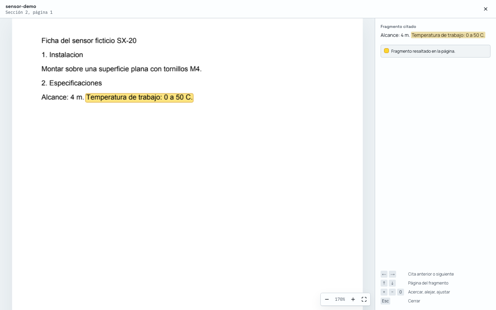
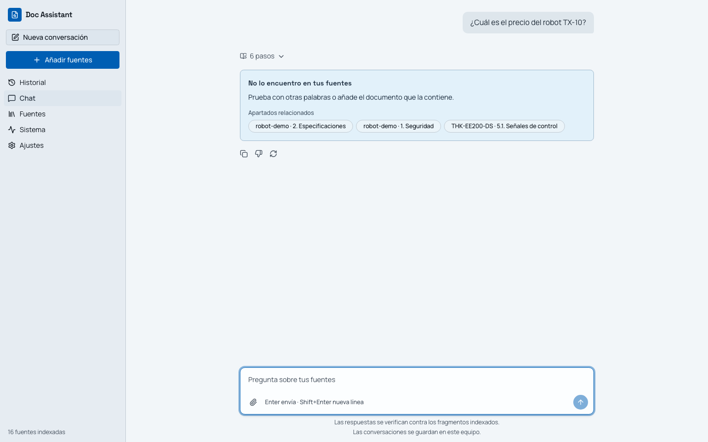
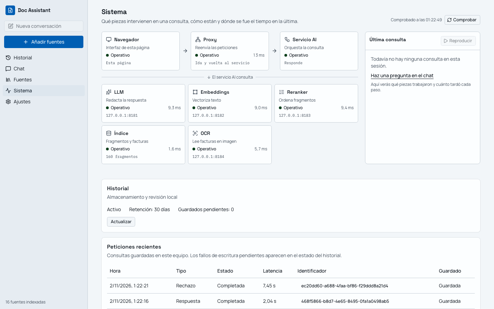

# Doc Assistant

Asistente local para consultar documentación técnica y facturas en lenguaje natural. Cada respuesta aceptada incluye documento, sección o página y fragmento verificable; si el sistema no encuentra respaldo suficiente, responde de forma explícita que no dispone de la información.

## Guía de lectura de 2 minutos

1. **[Arquitectura](docs/architecture.md):** explica las capas, el flujo de una pregunta, el flujo de una factura y dónde corre cada modelo.
2. **[Cobertura de requisitos](docs/requirements-coverage.md):** relaciona cada punto del enunciado con su implementación y una comprobación reproducible.
3. **[Evidencias](evidence/README.md):** reúne resultados, capturas y comandos para regenerarlos.
4. **[Decisiones](docs/decisions-log.md):** resume qué se eligió, qué se descartó y por qué.
5. **[Supuestos y huecos](docs/open-gaps.md):** separa lo demostrado de lo asumido y propone el siguiente paso.

Prueba visual rápida:

| Respuesta con citas y fragmento | Rechazo fuera de alcance | Estado local del sistema |
|---|---|---|
|  |  |  |

## Arranque reproducible

Requisitos: conexión a Internet durante la primera instalación y [mise](https://mise.jdx.dev/).

```sh
mise install
mise run setup
mise run start
```

Abre <http://127.0.0.1:3000>. `Ctrl-C` detiene la web, el servicio y los cuatro servidores de modelos.

El ZIP de entrega ya contiene los cinco GGUF y los binarios fijados de llama.cpp para macOS ARM64, Linux x64 y Windows x64. `setup` verifica sus SHA256 y no vuelve a descargarlos. Las dependencias Python y npm sí se instalan desde sus lockfiles.

### Demo con datos de ejemplo

La demo automática arranca el stack, ingiere dos PDF y seis facturas sintéticas, ejecuta tres preguntas contestables y dos rechazos, guarda métricas y cierra todos los procesos:

```sh
mise run evidence --live
```

Resultado: [`evidence/live/results.md`](evidence/live/results.md). Para recorrerlo en la interfaz:

1. Ejecuta `mise run start`.
2. En **Añadir fuentes**, carga `evidence/fixtures/docs/sensor-demo.pdf` y `evidence/fixtures/invoices/factura_001.png`.
3. Pregunta «¿Qué alcance tiene el sensor SX-20?», «¿Cuál es el importe total de la factura F-2026-001?» y «¿Quién ganó el mundial de 2010?».
4. Abre las citas y la vista **Sistema** para comprobar fragmento, página, modelos y tiempos.

## Hardware de prueba y modelos

Medido el 1 de noviembre de 2026 en:

- macOS 26.6.2, build 25G83.
- Apple M4, CPU de 10 núcleos y GPU de 10 núcleos.
- 16 GiB de memoria unificada. En Apple Silicon no existe una cifra de VRAM separada: CPU y GPU comparten ese presupuesto.

Comandos usados:

```sh
sw_vers
sysctl -n machdep.cpu.brand_string hw.physicalcpu hw.logicalcpu hw.memsize
system_profiler SPDisplaysDataType
```

| Función | Modelo local | Configuración | Motivo de la elección |
|---|---|---|---|
| Respuesta y plan de factura | Qwen3.5 4B | Q4_K_M, contexto 8192, 2 slots, razonamiento desactivado | Cabe junto al resto de modelos en 16 GiB y mantiene latencias interactivas. |
| Embeddings | bge-m3 | Q8_0, 1024 dimensiones | Recuperación multilingüe; su tamaño permite conservar más precisión que una cuantización agresiva. |
| Reranking | bge-reranker-v2-m3 | Q8_0 | Reduce falsos candidatos antes del LLM sin usar servicios externos. |
| OCR | GLM-OCR + proyector | Q8_0, contexto 8192, imagen limitada a 1600 tokens | Se ejecuta con llama.cpp y evita depender de otro runtime o de una API. |

La justificación completa, las alternativas descartadas y las medidas de RSS y latencia están en [Modelos y hardware](docs/modelos-hardware.md).

## Cómo se protege la fundamentación

- La recuperación combina búsqueda vectorial y BM25, reordena candidatos y limita el contexto.
- El LLM debe devolver respuesta y citas estructuradas. El servicio comprueba que las citas existen y que sus fragmentos respaldan la salida; si falla, retira el texto provisional y rechaza.
- Las consultas de facturas se resuelven sobre columnas tipadas y una lista cerrada de operaciones. El LLM propone una intención, pero no calcula importes ni elige silenciosamente entre facturas ambiguas.
- Los campos de factura sin evidencia son `null`; una suma o un IVA incoherentes dejan la factura en estado `revisar`.

Es una defensa por capas, no una promesa imposible de demostrar con una muestra finita. La evaluación pública es sintética y reproducible; el paso previo a producción es acordar un conjunto independiente con documentos representativos.

## Comandos de verificación

```sh
mise run check             # lint, tipos, tests, enlaces, contrato y build
CI=1 pnpm --filter web e2e # interfaz y accesibilidad
mise run evidence          # e2e deterministas de interfaz y accesibilidad
mise run evidence --live   # modelos reales, fixtures sintéticos y capturas finales
mise run package           # ZIP autocontenido y smoke en limpio
```

`services/ai/openapi.json` es la fuente del contrato y el cliente TypeScript se genera a partir de ella. El check falla ante cualquier deriva.

## Ejecución local y datos

Todos los procesos escuchan en loopback:

| Pieza | Puerto |
|---|---:|
| Web | 3000 |
| API | 8000 |
| LLM | 8081 |
| Embeddings | 8082 |
| Reranker | 8083 |
| OCR | 8084 |

No se usa ninguna API de inferencia ni se transmite contenido a terceros. La conexión de instalación no forma parte del procesamiento. Los documentos, índices, historial y feedback permanecen en el equipo.

## Alcance y límites

- Instalación local de un solo usuario. Multiusuario, SSO, ACL por colección y cola durable están diseñados, no implementados.
- Verificado de extremo a extremo en macOS ARM64. Los binarios de Linux x64 y Windows x64 se empaquetan, pero esas plataformas no se han probado físicamente.
- Los PDF con texto se resaltan en página. Para facturas se muestra el fragmento OCR, pero no su rectángulo sobre la imagen.
- Las métricas proceden de datos sintéticos en el hardware indicado; no son un SLA ni una estimación de precisión general.

Detalle y plan de mejora: [Supuestos y huecos](docs/open-gaps.md). Índice del resto de documentación: [docs/README.md](docs/README.md).
