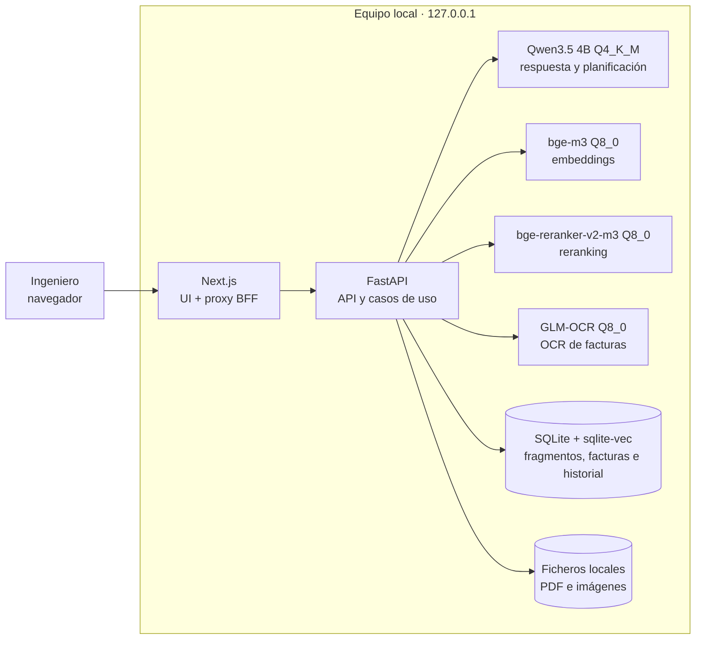
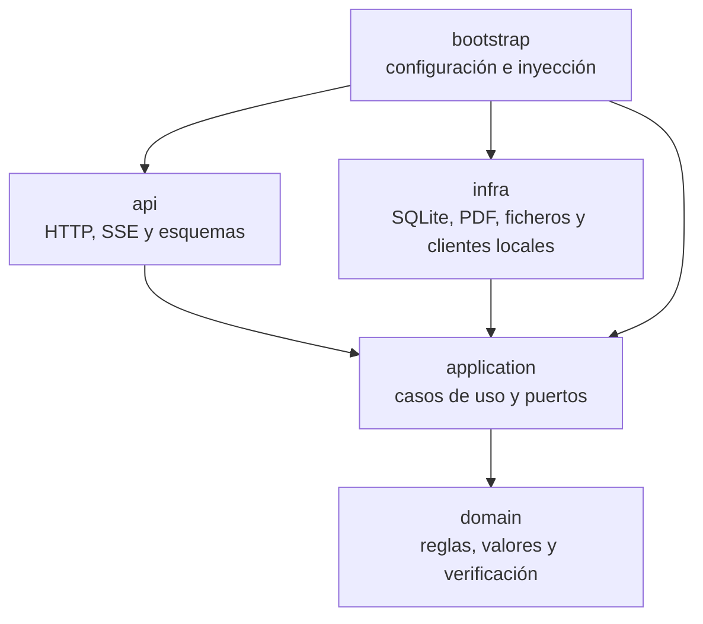
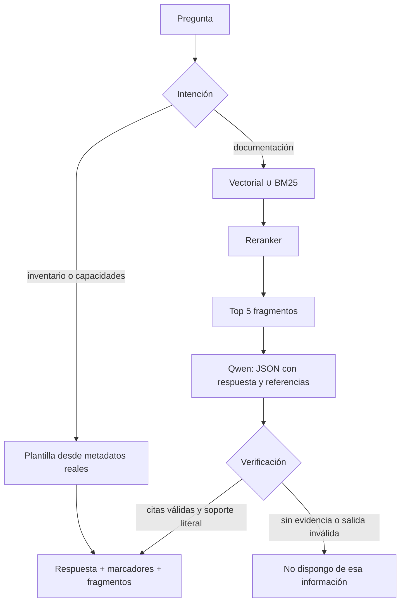
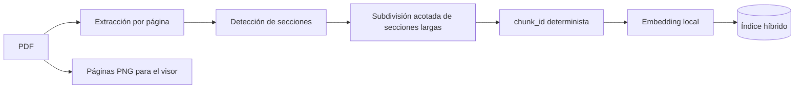
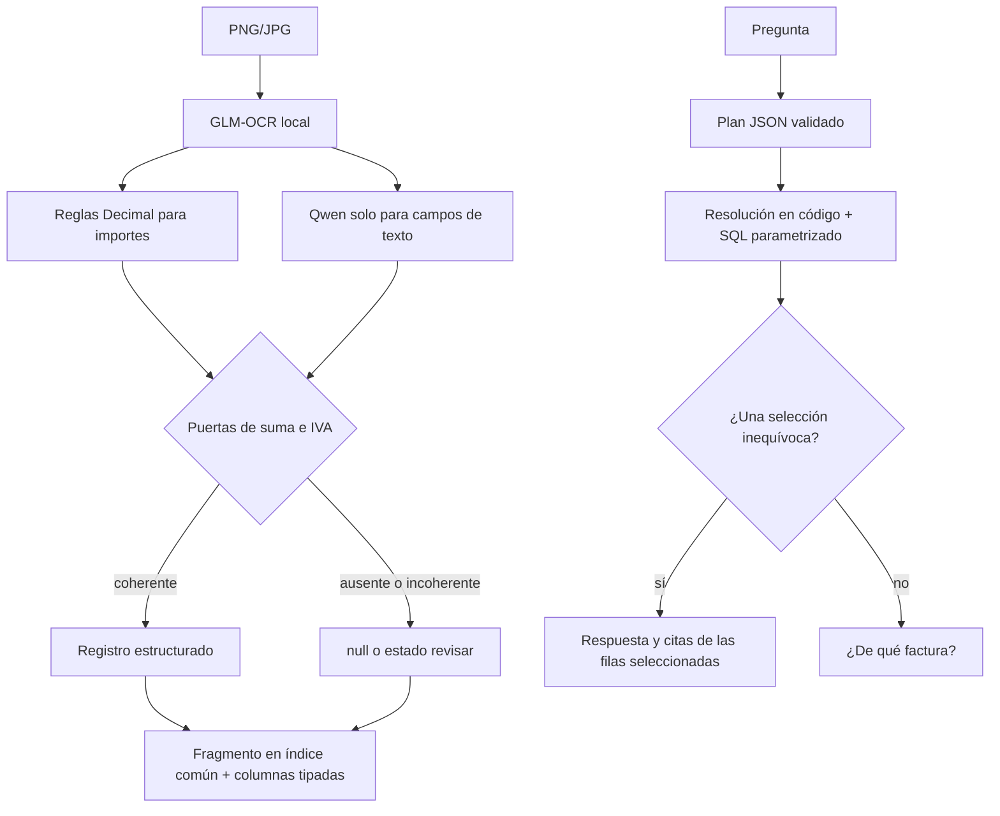

# Arquitectura

## Objetivo de diseño

La prioridad es responder solo cuando existe evidencia revisable. La interfaz puede mostrar progreso y texto provisional, pero el resultado final pertenece al servicio: una respuesta verificada con citas, una aclaración o un rechazo explícito.

## Componentes y ejecución local

No hay llamadas de inferencia externas. Web, API y modelos escuchan en loopback. El acceso a Internet solo se usa al instalar las dependencias fijadas.

## Capas

- `domain` no conoce FastAPI, SQLite, HTTP ni variables de entorno.
- `application` coordina casos de uso y define los puertos que necesita.
- `infra` implementa esos puertos.
- `api` traduce HTTP/SSE a tipos de aplicación; no importa infraestructura.
- `bootstrap.py` conecta las piezas.

`tests/unit/test_architecture.py` comprueba el grafo de imports, sus ciclos y las entradas raíz. En la web, cada feature expone una API pública y una regla local de ESLint impide acceder a interiores de otras features.

## Flujo de una pregunta documental

La búsqueda híbrida compensa dos fallos distintos: embeddings para paráfrasis y BM25 para identificadores o términos exactos. El reranker reduce el contexto que recibe el LLM. El modelo no tiene la última palabra: una cita debe apuntar a un fragmento recuperado y el verificador comprueba soporte literal y cantidades. Una salida que no pasa se retira y se transforma en rechazo.

El SSE emite pasos y puede mostrar texto provisional marcado como «verificando». Solo `done` es definitivo. Esta decisión reduce la espera percibida sin aceptar texto no verificado.

## Ingesta y troceado de PDF

El fragmento conserva documento, sección y rango de páginas. Los identificadores deterministas hacen idempotente la reingesta. Las secciones largas se dividen antes de generar embeddings para no exceder contexto.

Se eligió troceado por estructura porque mantiene juntos título y contenido y produce citas comprensibles. La comparación reproducible de `evidence/chunking/` conservó completos 6/6 hechos sintéticos frente a 2/6 con ventanas fijas de 64 caracteres. Es una comprobación de integridad literal, no una medida de recall; documentos sin encabezados o con maquetación irregular necesitan una estrategia adicional.

## Flujo de una factura

Campos: número, fecha, emisor, cliente, NIF, base imponible, IVA, IRPF, total e IBAN cuando existe. Un campo sin evidencia queda `null`; no se completa por conocimiento general. Las sumas y filtros se ejecutan en código sobre columnas cerradas y céntimos enteros. El LLM solo propone la intención y las pistas, nunca genera SQL libre ni calcula el resultado.

La factura se incorpora al mismo catálogo e índice que los PDF, pero conserva tablas tipadas para agregados fiables. Si varias filas encajan, la interfaz pide una aclaración en lugar de escoger una.

## Modelos frente al hardware

Los cuatro servidores se ejecutan simultáneamente en un Apple M4 con 16 GiB de memoria unificada:

- Qwen3.5 4B Q4_K_M para reservar margen a web, API, índice y otros modelos.
- bge-m3 y bge-reranker-v2-m3 Q8_0: modelos pequeños donde una cuantización menos agresiva cabe en el presupuesto.
- GLM-OCR y su proyector Q8_0 con contexto 8192 e imagen limitada a 1600 tokens.

La selección, alternativas y medidas se justifican en [Modelos y hardware](modelos-hardware.md). Los nombres, tamaños, URLs y SHA256 viven en `scripts/assets.json`.

## Contrato y persistencia

`services/ai/openapi.json` es la fuente de verdad. `openapi-typescript` genera el cliente y `mise run check` falla si hay deriva.

SQLite almacena fragmentos, vectores, facturas e historial local. Las operaciones de factura son transaccionales. El historial usa WAL, retención configurable y token efímero entre el proxy y la API; esto protege una instalación local, no sustituye identidad ni autorización multiusuario.

## Concurrencia, errores y seguridad

- Dos consultas activas y cuatro en espera por proceso, con timeout de 60 s.
- PDFium se serializa dentro del proceso para evitar uso concurrente inseguro.
- Rutas de subida confinadas al directorio de datos, nombres saneados y límites de tamaño/páginas.
- El proxy recodifica segmentos, limita cabeceras y comprueba el origen final.
- Errores tipados y recuperables para modelo ocupado, cola llena, timeout, fichero inválido y servicio no disponible.

La cola no es durable, no coordina varios procesos y no limita OCR. Son límites aceptados para una instalación local de un usuario.

## Escalado

El contrato separa interfaz, casos de uso, modelos y almacenamiento. La evolución propuesta añade SSO y ACL antes de recuperar, Postgres/pgvector, colas durables y workers OCR, y réplicas de inferencia on-premise por planta. Detalle y compromisos: [Escalado y despliegue](scaling-deployment.md).

## Verificación

- `mise run check`: lint, tipos, tests, arquitectura, enlaces, contrato y build.
- `CI=1 pnpm --filter web e2e`: interacción y accesibilidad.
- `mise run evidence`: capturas deterministas.
- `mise run evidence --live`: modelos reales y fixtures sintéticos.
- `mise run package`: paquete autocontenido, instalación y smoke desde un directorio limpio.

Los límites de lo demostrado están en [Supuestos y huecos](open-gaps.md); la trazabilidad completa está en [Cobertura de requisitos](requirements-coverage.md).
