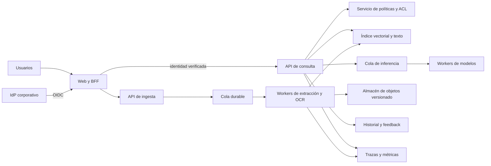

# Arquitectura multiusuario para una empresa

Estado: propuesta. El producto actual funciona en un equipo local para un usuario. Esta arquitectura describe un objetivo para cientos de usuarios registrados, no una capacidad medida ni implementada. El número de usuarios simultáneos, el volumen de documentos y los objetivos de servicio deben medirse antes de dimensionar la instalación.

La propuesta parte de [persistencia, historial y feedback](persistencia-historial-feedback.md). Esa propuesta local confía en una cabecera de identidad y usa SQLite; ninguna de las dos decisiones basta para un servicio accesible por varios usuarios. La identidad y la autorización deben comprobarse en el servidor antes de recuperar texto o devolver una fuente, una traza o un resultado cacheado.

## Flujo propuesto

Los bloques posteriores a la web son servicios lógicos. Pueden convivir al principio en menos procesos, siempre que las fronteras de autorización, durabilidad y recursos se mantengan.

## Identidad, inquilinos y permisos

Un inquilino identifica el dominio de administración y datos de una organización. Un usuario pertenece a uno o más inquilinos; cada petición selecciona uno de ellos y la API verifica esa pertenencia. Una instalación para una sola empresa puede tener un único inquilino, sin eliminar el identificador de las tablas y operaciones.

El BFF autentica mediante OIDC con el proveedor corporativo. La sesión usa cookies seguras y protección frente a CSRF. La API valida una credencial de servicio de corta duración y su audiencia, emisor y caducidad. No acepta `x-user-id` de un cliente como prueba de identidad. La red privada y TLS entre servicios complementan la validación. Las cuentas de servicio usan credenciales independientes y permisos mínimos.

Una ACL por documento concede permisos a usuarios o grupos del inquilino. Las operaciones de lectura, subida, administración de permisos y revisión de feedback se autorizan por separado. El propietario y los administradores se definen explícitamente; no se concede acceso global por defecto. Sincronizar grupos del IdP requiere una política para cambios y bajas, con caducidad de credenciales y revocación verificadas.

La recuperación aplica el filtro de inquilino y permisos antes de entregar candidatos al reranker o al modelo. El mismo control se aplica a búsqueda textual, SQL de facturas, vistas previas, páginas, descargas, historial, feedback y exportaciones. Los identificadores opacos no sustituyen a la autorización. Un filtro vectorial aproximado debe probar tanto aislamiento como recall; si el motor no garantiza el filtro antes de exponer candidatos, se necesita una partición o un mecanismo que sí lo haga.

Las citas apuntan a una versión inmutable del documento. Al cambiar o revocar una ACL, las respuestas cacheadas y las lecturas de citas deben respetar la política vigente. Una revisión histórica no permite recuperar contenido cuyo permiso actual se haya retirado, salvo una política de auditoría separada y explícita.

## Ingesta y almacenamiento

La subida guarda el original en almacenamiento de objetos cifrado, con identificador de inquilino, documento, versión y hash. Una transacción registra la versión y un evento de salida; un despachador publica ese evento en una cola durable. Así se evita que una escritura exitosa quede sin trabajo encolado si el proceso falla.

Los workers ejecutan extracción, OCR, fragmentación y embeddings en etapas con estados visibles. Cada etapa usa una clave idempotente derivada de inquilino, versión y configuración. Reintentos con espera y un límite de intentos conducen a una cola de errores revisable. Un worker publica una versión indexada completa mediante un cambio atómico de referencia; una ingesta fallida no sustituye la versión anterior. La capacidad de OCR se limita de forma independiente de la consulta para evitar que una carga masiva bloquee las preguntas.

Postgres puede guardar metadatos, ACL, trabajos, historial y feedback. Un índice con búsqueda vectorial y textual almacena los fragmentos, su versión y los filtros de autorización. `pgvector` es una opción inicial si las pruebas con la carga prevista cumplen los objetivos. Un motor dedicado es una alternativa cuando la escala o el aislamiento lo exijan. No hay un umbral universal de documentos que determine el cambio. Hay que medir recall filtrado, latencia, actualización, recuperación tras fallo y coste con datos representativos.

## Consulta, caché y capacidad

La API obtiene los permisos vigentes y recupera candidatos autorizados. Después ejecuta reranking, generación y verificación. Una cola acotada controla concurrencia y aplica límites por inquilino y usuario. Si no hay capacidad, el sistema informa de la espera o rechaza la petición con un error recuperable. Las réplicas y el batching aumentan capacidad solo hasta el límite que indiquen las pruebas de carga.

La caché de embeddings de ingesta puede usar hash del contenido y versión del modelo, dentro del límite de aislamiento elegido. Una caché de respuestas debe incluir inquilino, ámbito de permisos o revisión de ACL, versiones de documentos, índice, modelos y configuración. La invalidación por cambio de documento o permiso es obligatoria. Si no se puede demostrar esa invalidación, se desactiva la caché de respuestas. No se comparten fragmentos o respuestas entre inquilinos por coincidir la pregunta.

## Historial, privacidad y observabilidad

El historial se guarda en el servidor con `request_id`, identidad, inquilino, resultado, versiones y traza. El feedback referencia la petición y conserva una instantánea según la política de retención aprobada. La lectura y exportación vuelven a comprobar permisos. Las decisiones sobre texto literal, retención y rol revisor están en [decisiones pendientes](../decisiones-pendientes.md).

Trazas distribuidas conectan ingesta, recuperación, reranking, inferencia y verificación mediante un identificador de correlación. Las métricas incluyen latencia por etapa y percentiles, profundidad y edad de colas, errores, rechazos, uso de GPU, memoria y saturación. Los logs registran códigos y versiones, sin texto de documentos ni preguntas por defecto. El acceso a trazas con contenido requiere permisos y retención propios. Las evaluaciones continuas usan un gold aprobado y versionado; los cambios de modelo, índice o configuración se comparan con los mismos casos y umbrales fijados previamente.

## Despliegue y coste

La web, API, workers y modelos pueden empaquetarse en contenedores independientes. En cloud se separan nodos de CPU y GPU, con almacenamiento cifrado, copias de seguridad y restauraciones ensayadas. On-premise conserva el tráfico y los datos dentro de la infraestructura de la empresa, sujeto a su gestión de identidad, certificados, actualizaciones y capacidad. La compatibilidad con GPU depende del runtime y del hardware; no se presupone que un contenedor ofrezca Metal en macOS.

El coste incluye GPU reservada y utilizada, CPU de OCR e ingesta, almacenamiento de originales y versiones, índices, réplicas, red, copias, observabilidad y operación. Una estimación requiere horas de uso, concurrencia, longitud de contexto, volumen de páginas, retención y precios del entorno. No hay una cifra validada para cientos de usuarios. Dimensionar con pruebas de carga, medir utilización y coste por consulta e ingesta, y reservar capacidad para picos antes de prometer un nivel de servicio.

## Fases y puertas de salida

1. **Medir la base local.** Registrar carga, memoria, calidad y latencia con datos autorizados y gold aprobado. Definir objetivos y retención.
2. **Identidad y aislamiento.** Introducir SSO, inquilinos, ACL y pruebas negativas en todos los accesos, incluidas citas e historial. No exponer multiusuario hasta que esas pruebas pasen.
3. **Persistencia compartida e ingesta durable.** Migrar metadatos y trazas, añadir almacenamiento de objetos, cola y workers idempotentes. Probar caída, reintento y restauración.
4. **Escalar recuperación e inferencia.** Medir el índice filtrado y las colas con concurrencia representativa. Añadir réplicas o un motor dedicado según los resultados.
5. **Operación continua.** Integrar observabilidad, límites, políticas de retención, evaluaciones y ejercicios de recuperación. Revisar costes y capacidad con datos reales.

Cada fase requiere migración ensayada, rollback y criterios de aceptación propios. La propuesta no afirma que estén implementados SSO, ACL, colas durables, almacenamiento distribuido ni evaluación continua.
