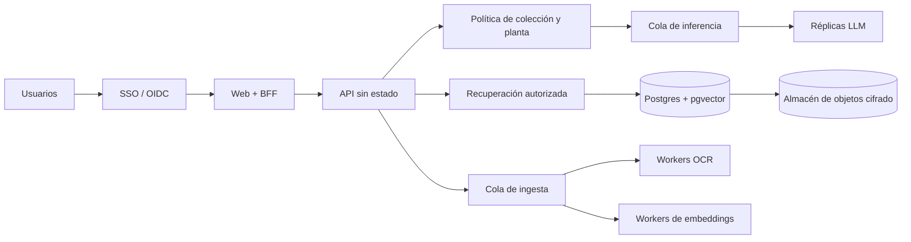

# Escalado y despliegue

El producto entregado es una instalación local para una persona. Esta propuesta describe la evolución a varias plantas y muchos usuarios; no presenta esas capacidades como implementadas.

## Principio rector

Los documentos sensibles deben filtrarse por permisos **antes** de recuperar fragmentos y antes de llegar a un modelo. Cifrar datos o filtrar la respuesta al final no evita una exposición.

## Arquitectura objetivo

## Evolución por pieza

| Pieza | Hoy | Siguiente etapa | Compromiso |
|---|---|---|---|
| Identidad | Usuario local implícito | SSO/OIDC y sesión en el BFF | Añade operación del IdP, pero evita identidad enviada por el navegador sin firma. |
| Autorización | Índice único | Colecciones por planta/equipo y ACL en cada consulta | Los filtros reducen recall si se configuran mal; necesitan tests de aislamiento. |
| API | Un proceso FastAPI | Réplicas sin estado | El historial y la admisión dejan de vivir en memoria. |
| Índice | SQLite + sqlite-vec | Postgres + pgvector o motor dedicado | Postgres simplifica transacciones y permisos; un motor dedicado puede ganar escala a costa de otra pieza. |
| Inferencia | llama.cpp local, 2 slots | GPU on-premise con varias réplicas y batching | Un modelo mayor solo se adopta si mejora el mismo gold sin romper latencia ni memoria. |
| OCR | Comparte equipo y presupuesto | Workers separados con cola durable | Aumenta latencia asíncrona, pero evita que una factura bloquee preguntas. |
| Ficheros | Disco local | Almacén de objetos cifrado y versionado | Hay que gestionar claves, retención y borrado. |
| Historial | SQLite, retención local | Postgres particionado por fecha y usuario | Requiere política corporativa y auditoría de accesos. |
| Observabilidad | Salud, pasos y tiempos | OpenTelemetry y métricas sin contenido sensible | Trazas útiles sin copiar documentos ni respuestas completas. |

## Estrategia para varias plantas

### Opción A · Una instalación por planta

- Modelos, índice y ficheros permanecen dentro de cada red.
- Un plano de control distribuye versiones y configuración, no documentos.
- Mejor aislamiento y continuidad si cae la WAN.
- Mayor coste operativo y riesgo de deriva entre instalaciones.

### Opción B · Servicio central on-premise

- Un clúster GPU y una base simplifican operación y evaluación.
- ACL por planta obligatorias antes de recuperar.
- Mejor uso de GPU, pero la red y el clúster se convierten en dependencias críticas.

### Opción C · Híbrida

- Ingesta, ficheros e índice por planta; modelos compartidos por región solo si la política permite enviar fragmentos.
- Reduce hardware duplicado, pero amplía la superficie de datos en tránsito.

Para documentación confidencial y conectividad industrial, empezaría por A o por un central on-premise dentro de la red corporativa. Nube pública solo sería aceptable con aprobación explícita, residencia de datos, cifrado y un proveedor que no retenga entradas; no es necesaria para escalar técnicamente.

## Capacidad y colas

La medida local identifica inferencia y OCR como cuellos de botella, pero no es una prueba de carga. El dimensionamiento debe partir de:

1. usuarios concurrentes y consultas por hora;
2. p50/p95 objetivo;
3. longitud real de contexto y respuesta;
4. porcentaje de consultas de facturas;
5. ventana de ingesta y tamaño del corpus.

La cola compartida aplica límites por usuario y prioridad: consulta interactiva antes que reindexado; OCR e ingesta en workers separados. `queue_full` debe seguir siendo explícito y recuperable.

## Despliegue

1. Imágenes firmadas para web, API y workers.
2. Modelos versionados por hash en un registro interno.
3. Migraciones de base separadas del arranque.
4. Despliegue canario con el mismo conjunto de evaluación.
5. Rollback conjunto de código, configuración y modelo.
6. Copias cifradas y pruebas periódicas de restauración.

El contrato OpenAPI y los puertos de aplicación ya separan web, servicio, modelos y almacenamiento. Cambiar de SQLite a Postgres exige un adaptador y pruebas de comportamiento; no obliga a rehacer la interfaz.

## Seguridad y privacidad

- TLS entre servicios y mTLS cuando crucen hosts.
- Cifrado en reposo con claves por entorno.
- ACL aplicadas en SQL/vector search, no después.
- Logs con identificadores y tiempos, sin fragmentos por defecto.
- Retención y borrado por colección y usuario.
- Feedback solo tras revisión y redacción de datos sensibles.

## Evaluación continua

Cada cambio de modelo, cuantización, prompt, chunking o índice ejecuta:

- gold independiente por tipo de documento;
- casos fuera de alcance y adversariales;
- precisión de cita y recuperación;
- extracción de factura por campo;
- latencia, memoria y carga;
- tests de aislamiento entre plantas.

Un aumento de respuestas sin respaldo bloquea el despliegue, aunque mejore la tasa de respuestas.

## Fases

1. **Piloto por planta:** instalación actual, corpus acotado, gold representativo y operación manual.
2. **Servidor compartido:** SSO, ACL, Postgres, cola durable y workers.
3. **Varias plantas:** despliegue automatizado, telemetría, copias y pruebas de aislamiento.
4. **Optimización:** réplicas y modelos dimensionados con carga real.

El salto de fase depende de evidencia, no de una cifra estimada de capacidad.
