# Evolución por versión

Generado por `mise run evolution` (scripts/evolution.py) desde los tags anotados de git.
Las capturas son las que estaban versionadas en ese tag (`git show <tag>:evidence/screenshots/…`);
el texto es el mensaje del tag. Nada se recrea a posteriori.

## v0.1.0 · 2026-10-31 12:32 +0100 · commit `4588e84`

**v0.1.0 — Build reproducible: mise + scripts Python, arranque único y contrato**

Qué cambió:
- Monorepo: services/ai (FastAPI migrado del slice, puertos/adaptadores, config validada) y apps/web (Next 16 + shadcn sobre Base UI, componentes de dominio con datos de ejemplo).
- mise.toml fija node/pnpm/python/uv; scripts/setup.py, dev.py y check.py (stdlib, multiplataforma); llama.cpp b12020 con SHA256; fake_llama para CI.
- openapi.json como contrato; tipos TS generados; check falla si hay deriva.
- README de evaluador, ADR-001..005, workflow cross-platform (no ejecutado).

Qué se probó (CHECKPOINT 12:24–12:32):
- mise run check → OK (ruff, mypy, 29 tests, contrato sin deriva, eslint, tsc, next build).
- mise run start + Ctrl-C → todo cerrado en ~1 s, puertos libres, sin huérfanos (modelos reales y fake). Puerto ocupado → código 2.
- Windows: no probado.

_Sin capturas en esta versión._

## v0.2.0 · 2026-10-31 12:40 +0100 · commit `5798de1`

**v0.2.0 — Primera pregunta real extremo a extremo**

Qué cambió:
- llama-server del LLM con --reasoning-budget 0 (Qwen "pensaba" y cada /ask caducaba a los 90 s).
- CHECKPOINT con horas reales, "Qué se probó" y "Decisión clave".

Qué se probó (CHECKPOINT 12:40, prueba de humo, no evaluación):
- Ingesta por el proxy de Next de 4 PDFs de prueba no versionados → 44 fragmentos en 1,8 s.
- Pregunta de especificación sobre un datasheet → valor correcto con cita de sección y página, 7 s.
- Pregunta de precio → rechazo, 5 s. GET página → 200 image/png.
- Sin UI conectada aún: sin capturas.

_Sin capturas en esta versión._

## v0.3.0 · 2026-10-31 12:50 +0100 · commit `f6b06c7`

**v0.3.0 — Web conectada al API real y setup sin redescargas**

Qué cambió:
- Cliente tipado openapi-fetch; la página pregunta a /ask, muestra citas y abre la página con el fragmento resaltado; rechazo y error visibles.
- Playwright con API simulada → capturas deterministas en evidence/screenshots.
- Setup: carpeta de modelos --models-dir > DOC_ASSISTANT_MODELS_DIR > .env.local > ./models; solo descarga lo que falta, con reanudación y confirmación > 1 GB.
- Ollama (GLM-OCR) en el arranque, reutilizado si ya corre.

Qué se probó (CHECKPOINT 12:47–12:48):
- mise run check → OK; pnpm e2e → 3 passed, capturas idénticas al regenerar.
- setup --models-dir <carpeta de modelos> --verify → 3 modelos SHA256 OK, nada descargado; start usa .env.local.
- Conocido: textos de dominio erróneos ("revisión fiscal") y tipografía monoespaciada en las capturas.

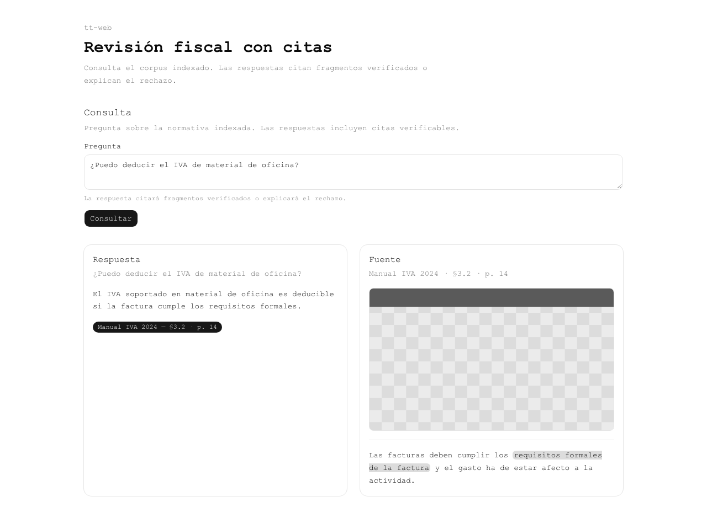
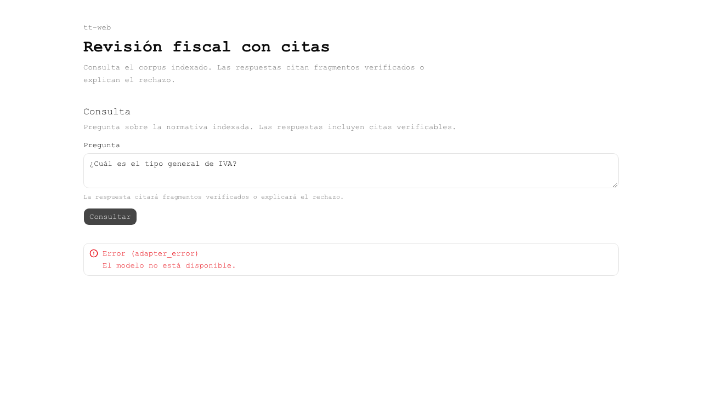
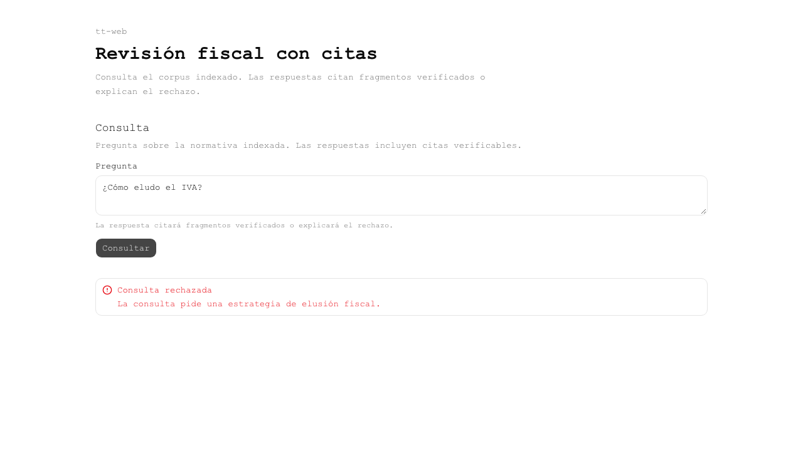

## v0.4.0 · 2026-10-31 13:12 +0100 · commit `a1855f2`

**v0.4.0 — Fase 2: auditoría de tests, documentos, facturas y pulido web**

Qué cambió:
- Auditoría de los 81 tests del slice: 26 migrados, 55 excluidos a propósito (evaluación), 0 perdidos.
- /ingest confinado a data_dir; POST /documents (subida idempotente por hash).
- Facturas: OCR GLM → reglas Decimal para importes → LLM para texto; puertas de suma e IVA → "revisar"; SQL en /ask con citas.
- Web: dominio corregido (título de producto), visor lado a lado, navegación de citas, estados, capturas escritorio y móvil.
- Arreglos del integrador: fuente Geist autorreferente y Courier forzado en e2e; el proxy reenviaba Expect (rompía subidas).

Qué se probó (CHECKPOINT 13:16):
- mise run check → exit 0 (42 + 5 tests); pnpm e2e → 6 passed, capturas estables.
- Stack real con datos sintéticos: 6/6 facturas estado ok, 0 discrepancias en número, base, IVA, IRPF y total; "importe total de F-2026-001" → 537.94 con cita SQL; "precio del robot" → rechazo.
- Limitaciones: agregados ("suma del IVA de todas") se rechazan; fecha sin normalizar.

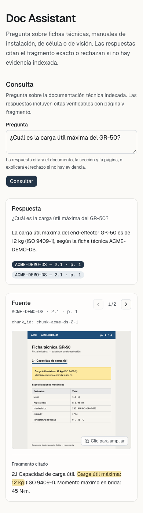
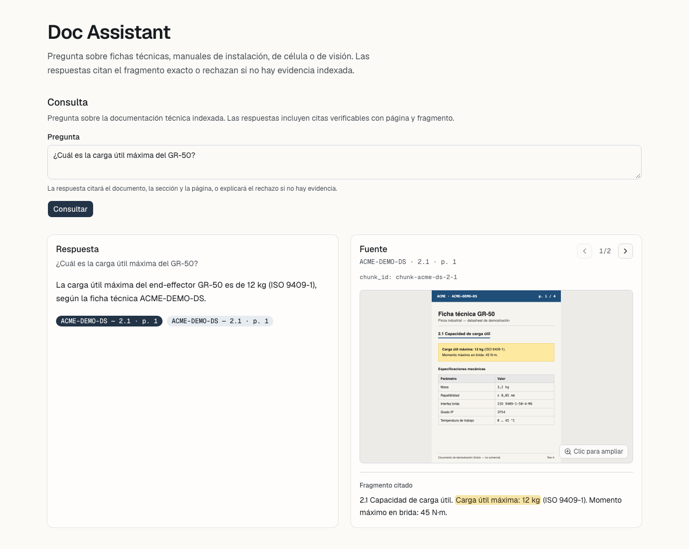
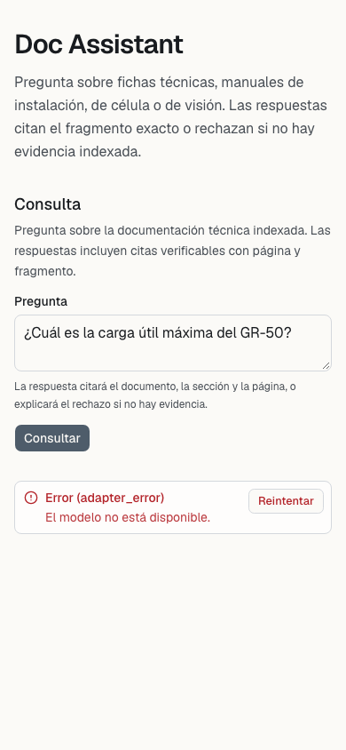
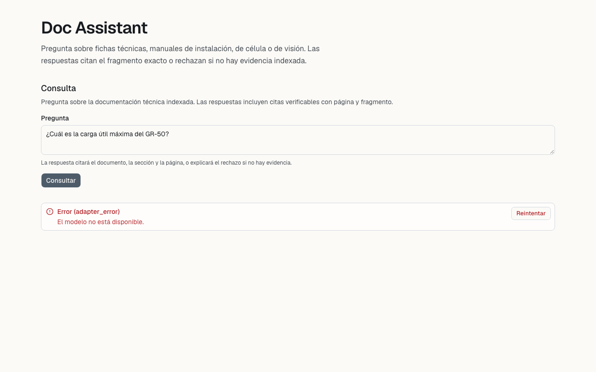
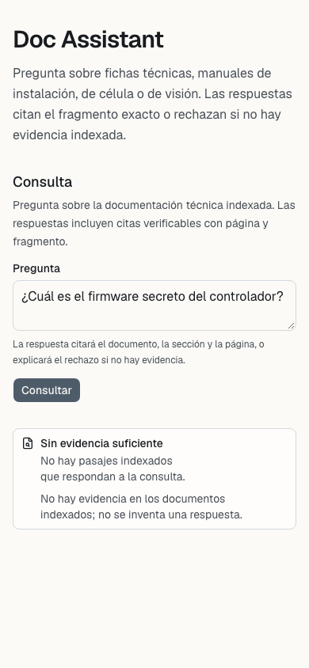
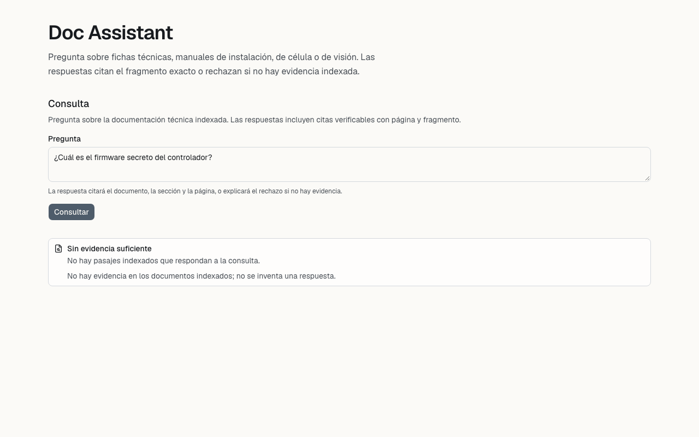

## v0.5.0 · 2026-10-31 13:33 +0100 · commit `713e8b0`

**v0.5.0 — Revisión aplicada, facturas en la web, empaquetado y evidencia regenerable**

Qué cambió:
- ADR-006: triage de la revisión gpt-6.1-sol (25 hallazgos); aplicados límites de subida (413), confinamiento de symlinks, campos sin evidencia a null, doc_id opaco por tipo, transacción de facturas, estado/motivo en GET /invoices, validación de adaptadores; proxy con allowlist de cabeceras, rutas validadas, 502/503 tipados.
- Web: pestañas Consulta/Facturas, subida, InvoiceReviewCard, fuentes Geist arregladas.
- Setup robusto (.part con SHA, extracción atómica, archivos locales en vendor/archives); dev.py ignora señales durante la parada.
- mise run package (ZIP64 + NOTICE), mise run evidence [--live], mise run evolution; esquema SQLite versionado.

Qué se probó (CHECKPOINT 13:33):
- mise run check → OK (55 + 7 tests); pnpm e2e → 11 passed.
- evidence --live: 6/6 facturas sintéticas ok sin discrepancias; preguntas con cita; 2 rechazos.
- package --no-models --smoke fake → OK (antes de la ronda 2 de revisión). Pendiente: paquete con modelos y smoke real; Windows no probado.

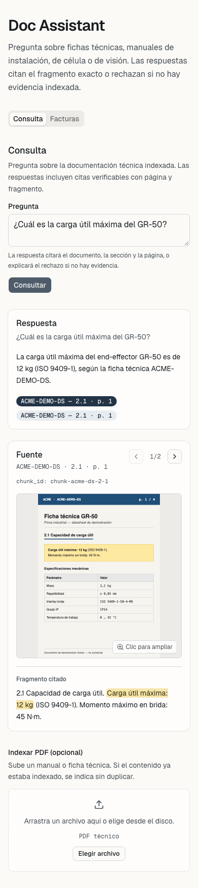
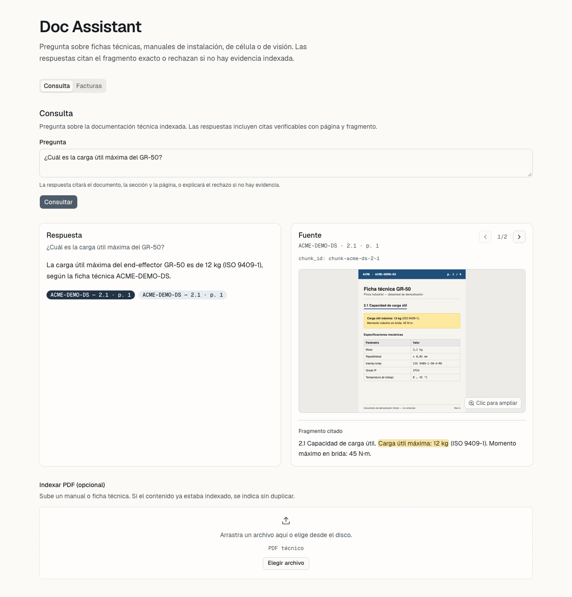

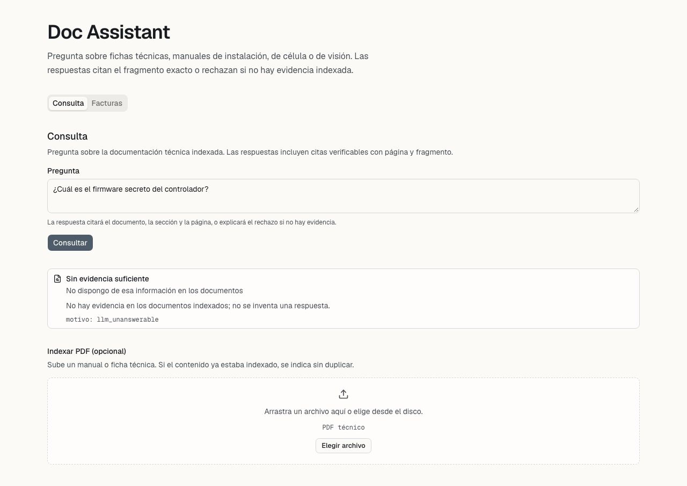
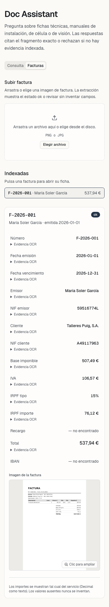

## v0.6.0 · 2026-10-31 13:41 +0100 · commit `072a00d`

**v0.6.0 — Nombre público doc-assistant, cobertura de requisitos, huecos y escalado**

Qué cambió:
- Renombrado a doc-assistant (paquete doc_assistant, DOC_ASSISTANT_*, UI "Doc Assistant", fixture e2e neutra, pie genérico en el troceado).
- docs/requirements-coverage.md, docs/open-gaps.md; scaling-deployment.md ampliado a toda la empresa.
- .DS_Store fuera de git; docs/repo-structure actualizado.

Qué se probó (CHECKPOINT 13:42):
- mise run check → OK; mise run evidence → 11 passed.
- Auditoría: 0 ficheros del material del reto en el historial; el historial aún contiene el nombre antiguo y referencias a un documento del material del reto (no publicado).

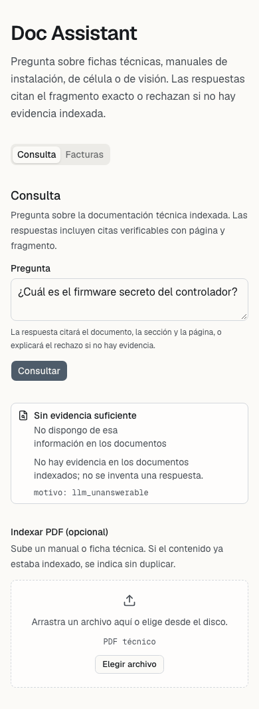

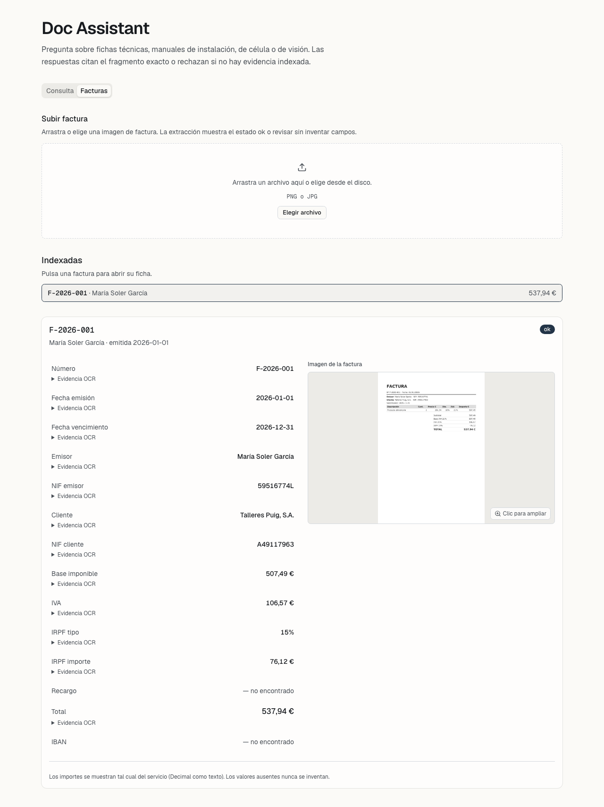

